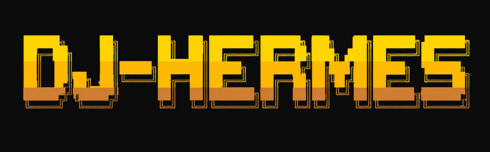

<p align="center">
  
</p>

# dj-hermes ☤

> the dj that grows with you

**Hermes plugin for uzu-language beat making.** Drop a beat by describing it:
Rhythmancer GGUF proposes a pattern, maelstrom (R) validates and renders an
offline WAV, and Strudel exports give a `strudel.cc` share link anyone can
click and hear.

> A "render" nobody can listen to is a defect. Every shipped example here is
> ≥ 15 s, RIFF-verified audio — enforced mechanically, listed below.

## The three paths

| Path | What | Needs |
|---|---|---|
| **A — offline render** | uzu pattern in `.R` → `render_stereo()` → real WAV | R + [maelstrom](https://github.com/frankiethull/maelstrom) |
| **B — live in browser** | `.strudel.cc` code → paste or share-link at [strudel.cc](https://strudel.cc) | a click |
| **C — direct** | you write the `.R` yourself | the same man/docs |

Rhythmancer 3B GGUF (Path-generating front-end) runs locally via llama.cpp and
writes **Strudel-dialect** code with tempo baked in as `.cpm(BPM/4)`;
`references/strudel-vs-maelstrom.md` is the verified bridge both directions.

## Repo layout

```
charter.md              # living source of truth: scope, principles, roadmap
skills/dj-hermes/       # umbrella skill: hard lessons + references + examples/
  examples/glm-5.3-flash/   # 4 hand-composed beats (.R + .wav + .strudel.cc + .md)
  examples/laguna-s-2.1-minimal/   # laguna beats (maelstrom vs. strudel vs. rhythmancer)
  examples/rhythmancer-gguf/# 1 beat generated verbatim by the GGUF, end-to-end
  defaults.yaml             # tempo/genre/render/strudel policy (never hardcoded)
  references/*.md           # verified API tables + workflow lessons
skills/dj-generate|render|validate|export|listen/   # sub-skills
plugins/dj-hermes/      # Hermes plugin: manifest + dashboard API + desktop UI
  scripts/check_examples.sh    # WAV duration/validity guardrail
  scripts/strudel_url.py       # strudel.cc share-link encoder/decoder
```

## Quick start

Path A (offline WAV, ~15 s):

```bash
cd skills/dj-hermes/examples/glm-5.3-flash
Rscript beat_deep_house_122bpm.R
ffprobe -v error -show_entries format=duration -of csv=p=0 beat_deep_house_122bpm.wav
```

Path B (clickable link, no browser scripting needed):

```bash
python3 plugins/dj-hermes/scripts/strudel_url.py encode \
  skills/dj-hermes/examples/glm-5.3-flash/beat_deep_house_122bpm.strudel.cc
# -> https://strudel.cc/#...   hand the user the link
```

Path G (Rhythmancer GGUF, optional):

```bash
hf download Nanite-Labs/nanites-rhythmancer-3b-generator-gguf \
  rhythmancer-Q4_K_M.gguf --local-dir ~/models/rhythmancer
llama-cli -m ~/models/rhythmancer/rhythmancer-Q4_K_M.gguf -ngl 99 -no-cnv \
  -f prompt.txt -n 400 -c 2048 --temp 0.7 --top-p 0.9 --repeat-penalty 1.1
# prompt.txt = ChatML, user turn: "Generate Strudel live-coding music code for: <beat> at <N> bpm"
```

## Guardrails (read before generating anything)

- **Timing:** 1 maelstrom cycle = 1 bar of 4/4 → `cps = bpm / 240` (maelstrom)
  / `setcpm(bpm / 4)` (Strudel). Never `bpm / 60` — that silently produced
  3-4 s WAVs in past sessions.
- **Render length:** `cycles = max(8, ceiling(15 * bpm / 240))`; every WAV must
  satisfy `render_policy` in `skills/dj-hermes/defaults.yaml`. Enforcement:
  `bash plugins/dj-hermes/scripts/check_examples.sh` (exit non-zero on
  violations — run it in CI / before shipping).
- **maelstrom≠Strudel:** methods are cousins, not twins — `.degrade()` is
  0-arg in Strudel, `.synth` doesn't exist there, `arp` takes 2 args. The
  verified, paste-error-driven table lives in
  `skills/dj-hermes/references/strudel-vs-maelstrom.md`.
- **Propose → validate:** Rhythmancer output routinely carries defects
  (unbalanced parens, truncated bank names). Validate before shipping,
  always.
- Session-verified pitfalls (parser hangs, pitch spelling, `pan()` arities…)
  are embedded in the skills — see `skills/dj-hermes/SKILL.md` "Hard
  Lessons" and `references/workflow-lessons.md`.

## For agents working in this repo

Start at `skills/dj-hermes/SKILL.md` — the umbrella skill governs all beat
work, embeds the correction history, and points to the verified references.
Anything you render must pass `check_examples.sh`; anything you export to
Strudel must use the `strudel-vs-maelstrom.md` table; anything you hand a
user ends with a playable link (`strudel_url.py encode ...`).

## Licensing & provenance

- Plugin/skill code: MIT
- maelstrom: MIT — https://github.com/frankiethull/maelstrom
- Rhythmancer 3B (Apache-2.0, Qwen2.5-Coder-3B base): training data is 100%
  synthetic (template-generated)
- Strudel: AGPL-3.0, live export is plain code emission, no embedding
